# ParagliderToolbox

Tools for paraglider simulation and games, built with the [Atelier](https://github.com/Tokter/Atelier) UI framework.

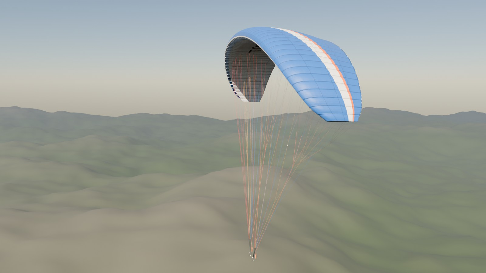

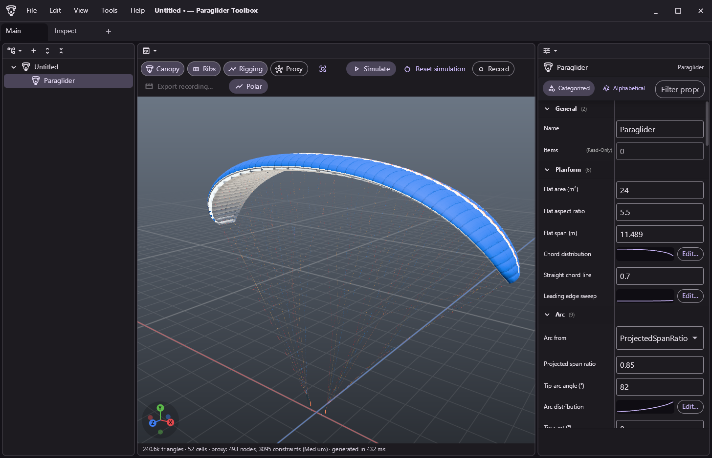

## The application shell

- **Project tree** (left): every object in the project. Right-click for Add, Rename, Duplicate, Delete and Move.
- **Detail view** (middle): the selected object's own UI.
- **Properties** (right): the selected object's properties.
- **Workspaces**: Blender-style areas that split, join and swap, each showing any of the views; workspaces in tabs.
  The layout is remembered.
- **Projects** are saved as JSON (`*.pgtproj`) from the File menu in the title bar, with recent files.
- **Command palette** (Ctrl+Shift+P) and **keyboard shortcuts editor** (Ctrl+K, Ctrl+S).

| Shortcut | Action |
|---|---|
| Ctrl+N / Ctrl+O / Ctrl+S / Ctrl+Shift+S | New, open, save, save as |
| Ctrl+Shift+P | Command palette |
| Ctrl+K, Ctrl+S | Customize keyboard shortcuts |
| Ctrl+Shift+N | Add a folder |
| F2 / Ctrl+D | Rename / duplicate the selected object |
| Delete, Alt+Up, Alt+Down | Delete or move the selected object (in the project tree) |
| Ctrl+Space | Maximize the area under the pointer |
| F12 | Developer tools (Debug builds) |

## Paraglider Model Creator

Add a paraglider (Ctrl+Shift+G, or Edit > Add) and shape it in the properties; the detail view regenerates the model
as you edit (a few hundred milliseconds) and can fly it.

Adding a paraglider asks for a starting point:

- **Wing class**: EN-A (school, aspect ratio 4.9, 40 cells), low EN-B (5.3, 48 cells), high EN-B (5.9, 58 cells), EN-C
  (two-liner, 6.3, 66 cells) or EN-D (two-liner, 6.9, 78 cells). Each preset sets every design parameter after current
  production wings of its class: planform and arc, profile thickness, shark nose and reflex, line rows, cascades and
  diameters, brake travel, pilot harness drag.
- **Model detail**: Low poly (a few hundred triangles for games: skin panels spanning several cells, lines as ribbons,
  a 1024 texture), Medium (tens of thousands for real time) or High (hundreds of thousands for renders). It can be
  changed later (Mesh > Detail), and editing any mesh setting makes it Custom.

- **Design parameters**, in the order of the design steps:
  - **Planform**: flat area, aspect ratio and span, chord distribution curve, straight chord line, leading edge sweep.
  - **Arc**: tip angle or a projected span ratio to solve for, the arc distribution, tip cant, washout and its axis.
  - **Airfoil**: a parametric reflexed section (NACA modified four-digit thickness: leading edge radius, maximum
    thickness position; camber, its position, reflex) or imported Selig/Lednicer `.dat` coordinates; root and tip
    thickness with a distribution curve.
  - **Inlet**: start and end, rim sag, shark nose, leading edge rods.
  - **Cells**: cell count, width distribution, mini-ribs, cross-vents, diagonal ribs.
  - **Ballooning**: amount and chordwise distribution, lower surface factor, seam creases, tab wrinkles, trailing edge
    gathering.
  - **Rigging**: 2, 3 or 4 rows and their positions, tab and brake tab spacing, cascades, line diameters, carabiner
    position and spacing, risers, brake slack and travel, trim.
  - **Appearance**: pattern, colors, brand text, texture size, fabric translucency.
  - **Physics proxy**: complexity from Arcade to High, or custom settings; masses and drag.
  - **Mesh**: detail (Low poly, Medium, High or Custom), resolution, cells per segment, ribs, rigging, line and hardware detail.
- Distributions are curves: drag their points in the curve editor (Edit… next to the curve).
- **High resolution model** (about 240k triangles by default): ballooned skin with seam creases, wrinkles and a gathered
  trailing edge, air inlets with sagging rims, internal ribs with cross-vents, mini-ribs and diagonal ribs, tip panels,
  the line cascades as tubes in their row colors, risers, maillons, brake pulleys and toggles, carabiners; procedural
  base color and normal map textures (pattern, panel seams, stitching, tapes, ripstop, brand text).
- **Physics proxy**: mass points on the upper and lower surface (or the camber surface), fabric, rib and bending
  constraints, tension-only lines that sag and bow when slack, risers, the pilot and the pilot's hands on the brake
  toggles, aerodynamic strips with ram-air pressure cells, the section polar and the pilot's controls. The high
  resolution model is skinned to it.
- **Simulation** in the detail view (P): trim glide, brakes (the toggles move down to the hips), speed bar, weight
  shift, asymmetric and frontal collapses, big ears, gusts, stalls and spins, with the high resolution model following
  the proxy. The canopy is fabric held in shape by its pressure: empty cells go limp, so collapses fold the canopy under,
  big ears fold the tips, a frontal folds the span into a horseshoe and a full stall crumples it; it reopens as the cells
  refill. The **Forces** view (5) draws the lift, canopy drag, line drag and pilot drag as arrows from where the
  simulation applies them, as long as they are strong: per node, or summed per strip at its center of pressure; with
  the totals and the force balance's L/D. It also shows the load the pilot hangs in the harness with (weight and
  inertia: down, and out of a turn), and the telemetry shows the G load.
- **Recorded flights** (Record, Ctrl+R): stopping a recording adds it under the paraglider, like a polar. Select it to
  replay it: play, pause, scrub the timeline, step frame by frame, slow it down to a tenth, and orbit and zoom around the
  glider meanwhile, with the flight data of every moment (airspeed, vario, G, angle of attack, deflated cells, the
  pilot's inputs). It keeps the design it was flown with (the paraglider can be edited on), the proxy's motion (30 frames
  a second, about 2.5 MB a minute in the project for a Medium proxy) and the pilot's inputs from the start of the flight,
  so the simulator can fly it again exactly: save the project to share something strange. Export it as a glTF animation.

  | Simulation: an asymmetric collapse | The physics proxy the high resolution model is skinned to |
  |---|---|
  | 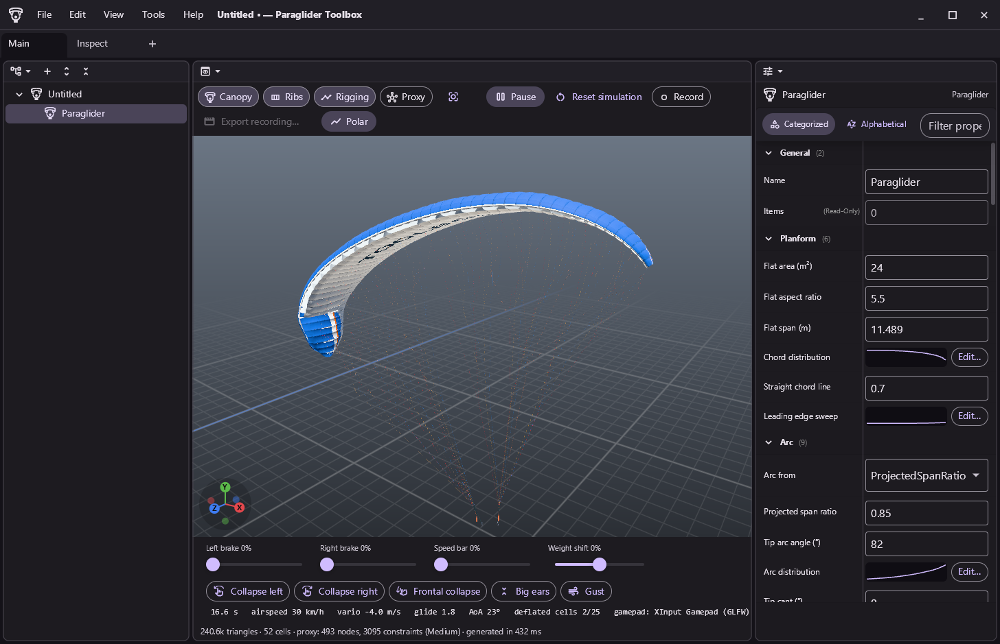 | 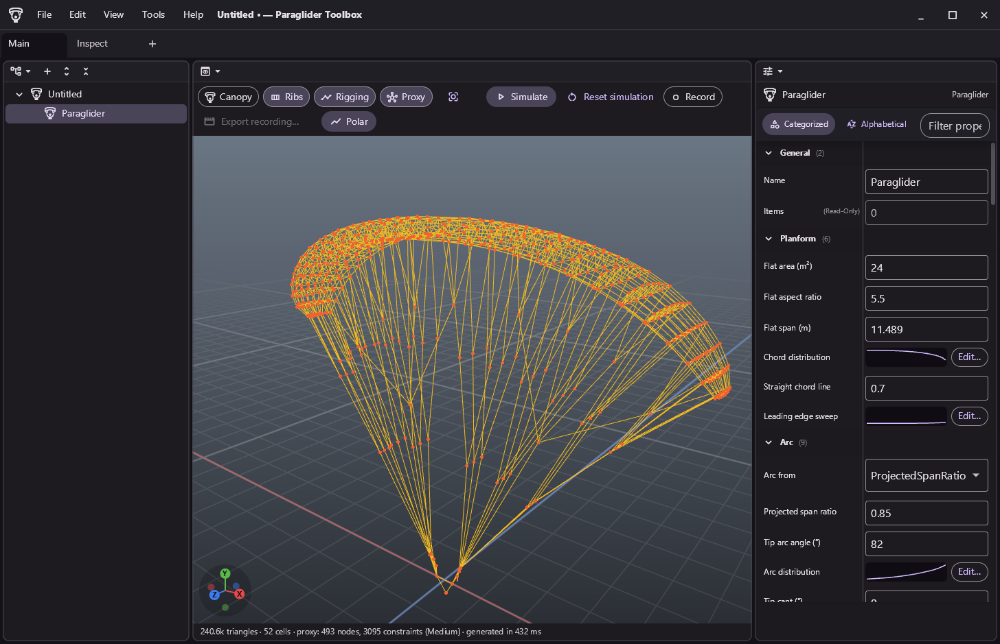 |
- **Polar recorder** (Polar button, Ctrl+P): flies the proxy headless and deterministically through the speed range
  (trim, the speed bar steps, then symmetric brake steps until it stalls), settling and then measuring each setting,
  and plots the samples live. A dialog sets it up first: the number of speed bar and brake steps (4 and 10 by default:
  25 % and 10 % apart), the maximum brake, start, ramp, settle and measure times, samples per second, and the stall and
  steadiness thresholds, with the resulting flight time. Sink rates are total-energy compensated, like a TE vario. The
  result is stored as a polar under the paraglider (with the
  design and settings it was recorded with and every sample) and shown on a zoomable chart with trim, full speed, best
  glide (tangent from the origin to the fitted curve), min sink, min speed, max sink and the stall labeled, plus a table of every setting.
  Export it as CSV. `PolarRecorder` is UI-free, the building block for an optimizer that tweaks parameters and
  compares polars.

  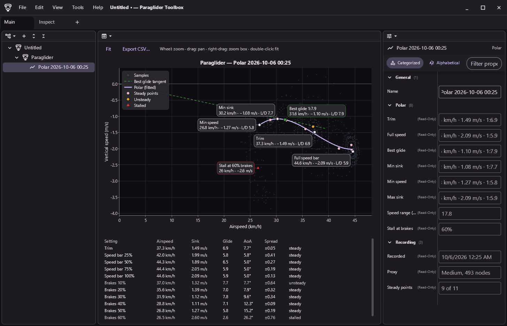
- **Exports** (File > Export paraglider, Ctrl+E, or the Tools menu): glTF binary with the skinned model, materials and
  textures (Blender, Godot), the proxy alone as glTF, the proxy JSON for a game ([format and algorithm](docs/ProxyFormat.md)),
  OBJ + MTL + PNG, and a line plan CSV.

| In the detail view | Action |
|---|---|
| Middle drag / Shift+middle drag / wheel | Orbit / pan / zoom |
| Home, numpad 1 3 7, numpad 5, Shift+Z | Frame, views, orthographic, wireframe |
| 1 2 3 4 | Show canopy, rigging, proxy, ribs |
| 5, 6, D, - and = | Show the aerodynamic forces; per node or per strip; drag ×5; shorter and longer arrows |
| P / R | Simulate or pause / reset |
| Q, E, F, B, G | Collapse left, right, frontal, big ears, gust |
| Ctrl+R | Record the flight (again to stop: it is added under the paraglider) |
| Ctrl+P | Record the polar (again to cancel) |
| Game controller (Xbox) | Left and right trigger: brakes; left stick: weight shift (left/right) and speed bar (forward); A: simulate or pause; left and right bumper: collapse left and right |
| In a recorded flight: P / R, comma and period, - and = | Play or pause / restart, step a frame back and on, slower and faster |

### Renders

Exported glTF models rendered in Blender 4.4 with Cycles (sky, procedural terrain and lighting added in Blender;
the canopy, ribs, rigging, textures and normal maps come straight from the export). `docs/images/render.py` renders
them again: `blender -b --python docs/images/render.py -- model.glb out hero,side,backlit,nose 256 1`.

`docs/images/render_flight.py` turns an exported recorded flight into a video: procedural mountains, a stand-in pilot,
and a camera that follows the glider (smoothed), slowly circles it and backs off whenever the wing would leave the
frame. Render a few stills to check the look, then every frame (it resumes), then encode them into `flight.mp4`:

```bash
blender -b --python docs/images/render_flight.py -- flight.glb out stills:0,120,240 32 0.5
blender -b --python docs/images/render_flight.py -- flight.glb out frames 64 1
blender -b --python docs/images/render_flight.py -- flight.glb out encode
```

| | |
|---|---|
| 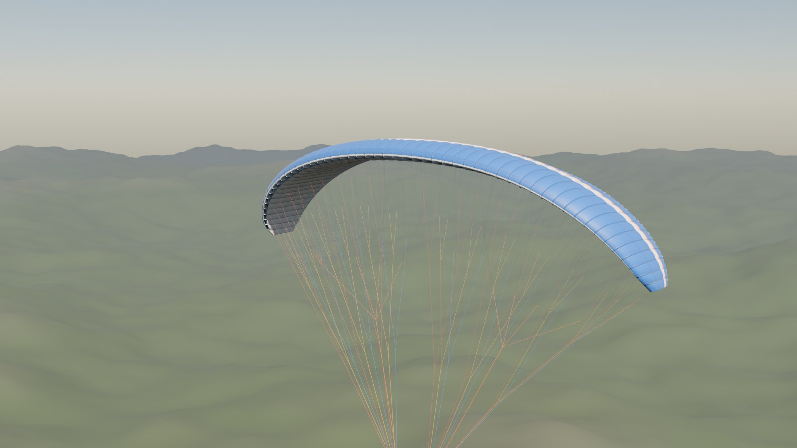 | 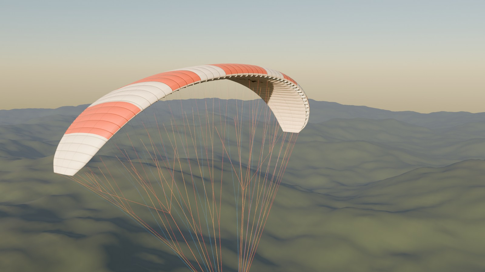 |
| 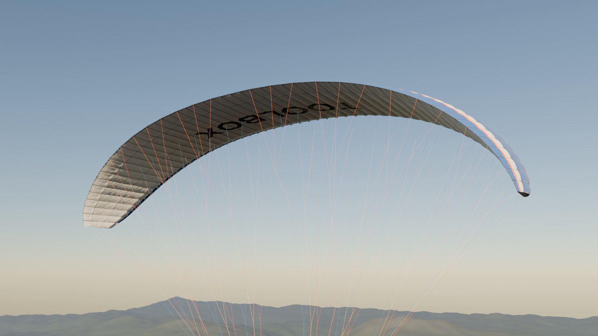 | 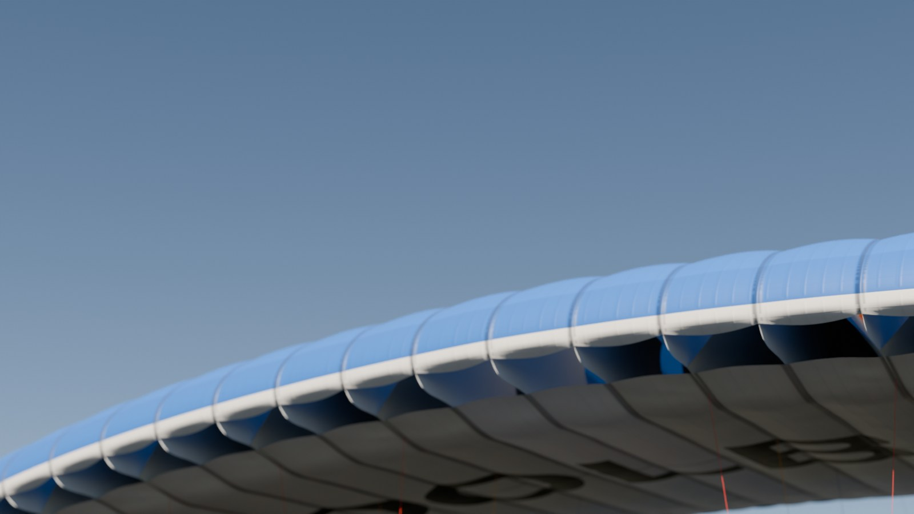 |

## Terrain Generator

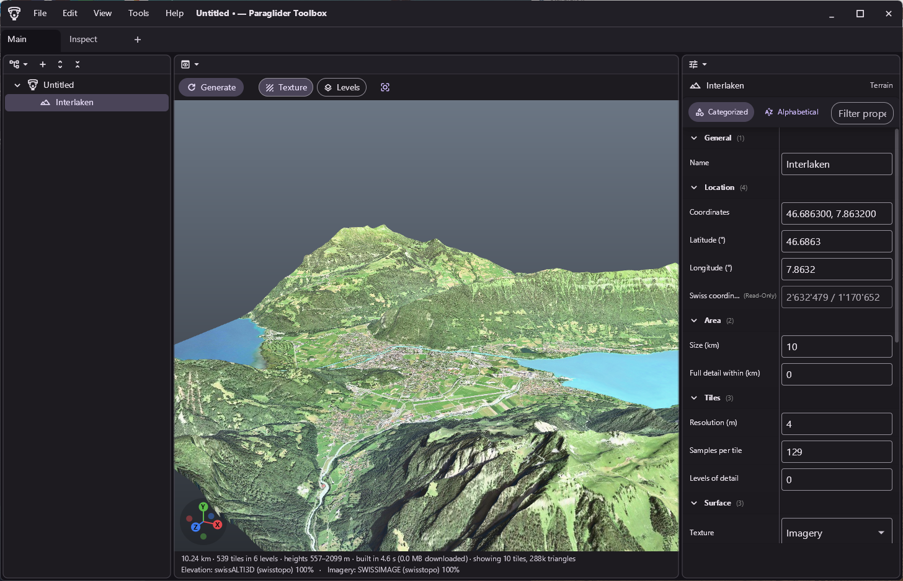

*Interlaken, 10 km at 4 m (the Game style): 539 tiles in 6 levels, built in 4.6 s from the cache. Data: © swisstopo.*

Add a terrain (Ctrl+Shift+T, or Edit > Add): paste a location (latitude, longitude as maps copy them, degrees with
N/E, or Swiss coordinates) or pick a paragliding site, and a style:

- **Arcade**: low poly, a few kilometers: faceted triangles in the colors of the aerial image.
- **Game**: about 10 km, detailed and textured.
- **Simulator**: 30 km, full detail (2 m) within 3 km of the center and coarser further out.

The detail view builds it (downloading only the parts of the data it needs, then from the cache) and shows the tiles
as they come in, coarse to fine; the camera chooses the levels of detail. While it builds, the line below the view
tells the level, the tiles and what has been downloaded. Every point takes the finest data there is (a coarse level
takes the coarsest source that is still fine enough for it, which has far less to download):

| Where | Elevation | Imagery |
|---|---|---|
| Switzerland | swissALTI3D (swisstopo), lidar, bare ground, 0.5 m | SWISSIMAGE (swisstopo), 10 cm |
| Around Switzerland (100 km and more beyond the border) | swissALTIRegio (swisstopo), bare ground, 10 m | Sentinel-2 cloudless 2016 (EOX), 10 m |
| Everywhere else | Copernicus DEM GLO-30, 30 m | Sentinel-2 cloudless 2016 (EOX), 10 m |

All of them may be used commercially; they require credit, which every export carries (`ATTRIBUTION.txt`). Where a
finer source's data ends, its heights ease into the next one's over 200 m.

The properties set the size, the finest resolution, the samples per tile (2^k + 1, as engines' heightmaps need), the
levels of detail (a quadtree: each level half as fine, a quarter as many tiles), a full detail area for large
terrains, the texture and the shading. Changing them marks the terrain out of date; Generate (G) builds it again.
**Export terrain tiles** writes a tile set for a game: per tile a glTF mesh (with skirts that hide the cracks between
levels), a 16-bit heightmap (PNG for Unreal and Godot, RAW for Unity) and a JPEG texture, and `terrain.json`, the
quadtree with its frame and height range ([docs/TerrainFormat.md](docs/TerrainFormat.md)). **Export terrain glTF**
writes the most detailed tiles as one file, for Blender.

| In the detail view | Action |
|---|---|
| G | Generate (again to cancel) |
| L / T | Tint the levels of detail / show the texture |
| W, A, S, D (held), E / Q, Shift | Fly through the landscape: where the camera looks, left, back, right; up / down; faster (the speed follows the height above the ground) |
| Right drag | Look around without moving |
| Middle drag / Shift+middle drag / wheel, Home, Shift+Z | Orbit / pan / zoom, frame, wireframe |

### Terrain renders

A terrain exported with Export terrain glTF and rendered in Blender 4.4 with Cycles: 20 km around the Lauterbrunnen
valley (center 46.565, 7.930; 4 m, 129 samples per tile, 512 px textures, full detail within 6 km; 394 tiles of three
levels, 12.7M triangles). The heights and textures come straight from the export; the sky, sun and haze are added in
Blender. `docs/images/render_terrain.py` renders it again, placing the camera by latitude and longitude:
`blender -b --python docs/images/render_terrain.py -- terrain.glb render.jpg jungfrau 128 1`. Data: © swisstopo.

| | |
|---|---|
| 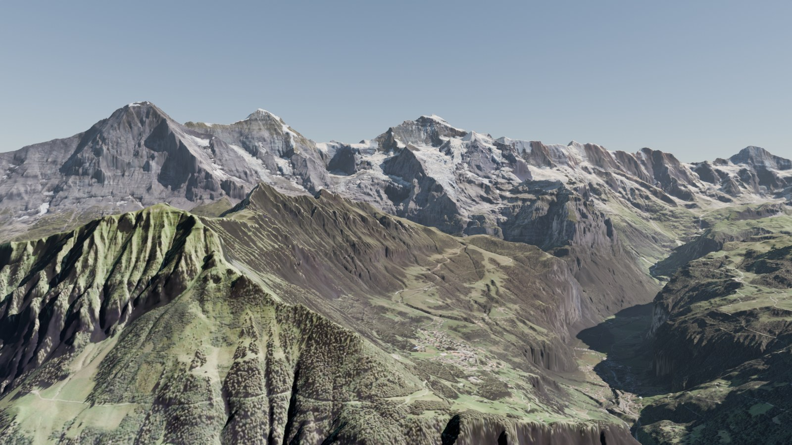 | 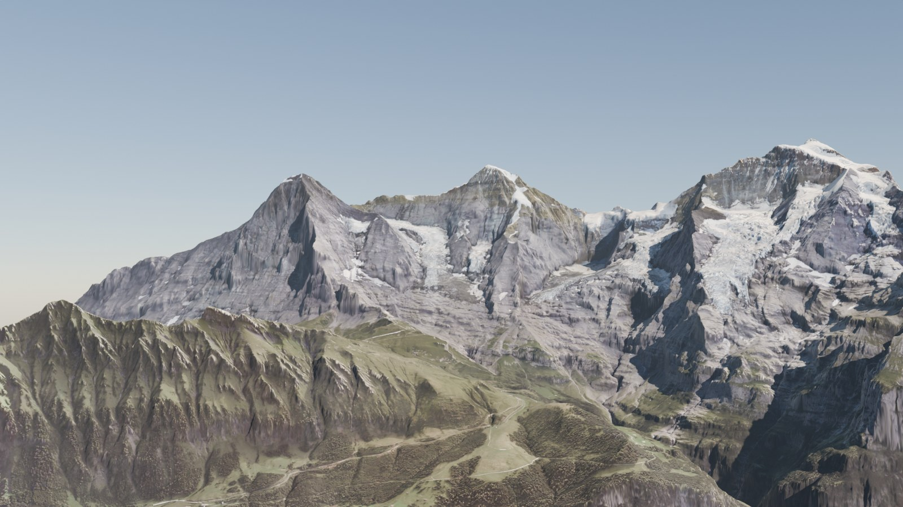 |

## Airflow Simulator

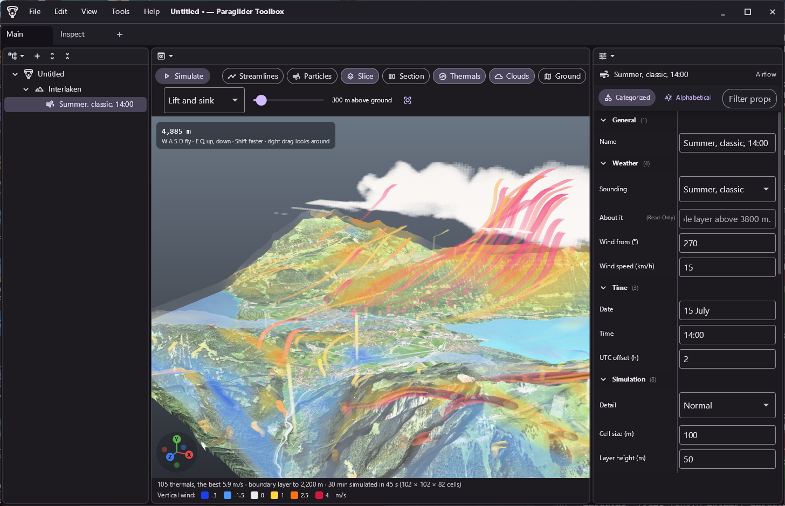

*A classic July afternoon over Interlaken at 14:00, west wind 15 km/h: 30 minutes simulated on 102 × 102 × 82 cells in
45 s. The slice 300 m above the ground shows the lift over the sunny slopes and the sink over the valley and the lakes,
which are colder than the afternoon air; 105 thermals lean with the wind from the slopes, the higher ones under
cumulus. Data: © swisstopo.*

An airflow belongs to a terrain: select the terrain and add one (Ctrl+Shift+A). Choose a sounding (premade morning
soundings of the Alpine foreland: spring unstable, spring inversion, a classic summer day, thundery, high pressure, an
autumn valley inversion, winter, föhn), the wind (where it comes from and its speed) and the time of day, then Simulate
(R). The fluid solver ([docs/AirflowFormat.md](docs/AirflowFormat.md)) runs over the terrain:

- **Wind**: incompressible flow over the terrain cut into the grid's cells, so it follows slopes, speeds up through
  passes (venturi), rises on windward slopes, sinks and separates in the lee; the sounding's stratification makes the
  air resist rising, so föhn makes lee waves and rotors.
- **Thermals**: the sun of that date and time heats every slope by its angle to the sun and its shadows, and by what
  covers it, read from the aerial images (meadow, forest, fields, rock, towns, water, snow); the day's heat so far has
  grown the boundary layer out of the morning sounding, whose inversions cap the thermals; rising moist air condenses
  into cumulus at the cloud base. Lakes keep the season's water temperature: colder than the afternoon air, they cool
  it and the air sinks over them; warmer, as in autumn, they warm it. Thermals lean with the wind from where they leave
  the ground.
- **Result**: averaged over the last 10 minutes: the mean wind, the turbulence, how often and how strongly the air
  rises, the clouds, maps of the ground's heating, the boundary layer's top and the cloud base, the thermals and their
  likely triggers. It is saved with the project; **Export airflow** writes it for a game (`.airflow`).
- **Speed**: on a graphics card (CUDA, or OpenCL) the solver runs about 20 times faster than on the processor: the
  30 minutes above take 2 s on an RTX 4090 instead of 45 s, and the same 10 km at 50 m cells (6.8 million) 28 s.
  Without a card it runs on the processor's cores.

The detail view shows the flow live while it develops and the result afterwards: a slice at a height above the ground
(lift and sink, turbulence, wind, lift chance or warming), a vertical section along the wind, streamlines, particles
streaming like streamers, the thermals with their cumulus, the clouds, and the ground's heating or land cover with the
thermal triggers. The camera flies as in the terrain view (W, A, S, D).

| | |
|---|---|
| 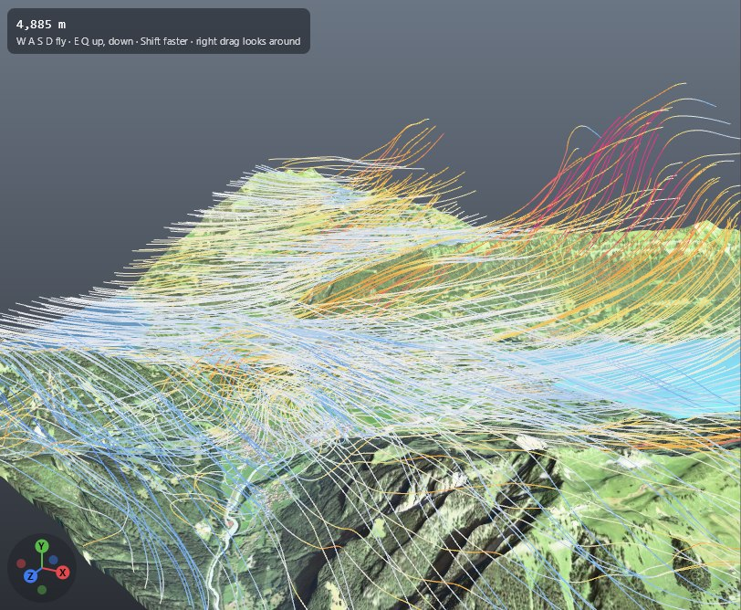 | 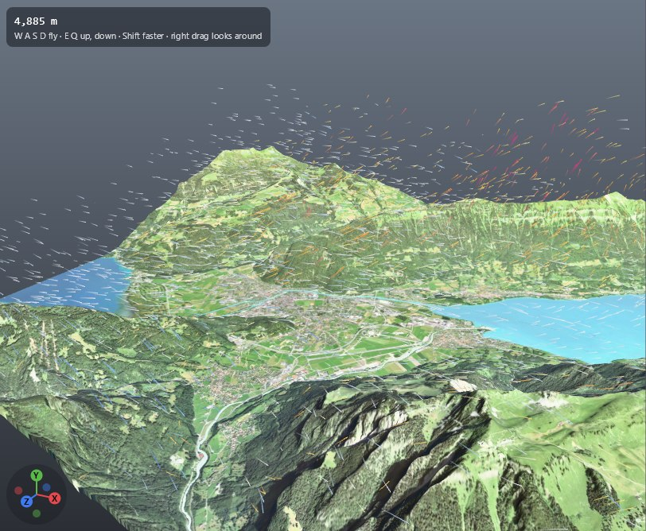 |

| In the detail view | Action |
|---|---|
| R | Simulate (again to cancel) |
| B | Without the thermals: the base flow a game plays its thermals over (after a Thermals run) |
| U | The sun: where it stands, its light falling on the terrain |
| H / V / L / P | Slice above the ground / vertical section / streamlines / particles |
| T / C / G | Thermals (or their sites) / clouds / ground map with the triggers |
| N, Page Up / Page Down | The slice's next quantity, raise / lower it by 100 m |
| O | Over time: the run's clouds and lift as they come and go, or its mean |
| Space, Home, `,` / `.`, − / = | Play or pause the run, back to its start, half a minute back / on, slower / faster |
| M | Game: the run's thermals and cumulus played as a game would (Space pauses, − / = slower / faster, Home another sky) |

### Over time

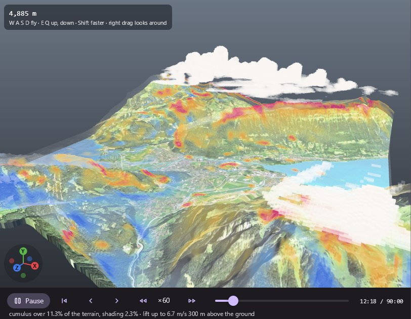

The detail **Thermals** resolves the thermals themselves: about 200 cells across the terrain (50 m over 10 km) for 90
minutes, the clouds shading the ground, and room above for the cumulus to grow. Thermals rise from the sunny slopes and
grow cumulus; a cumulus' shadow cuts the heat under it and its thermal dies while new ones start elsewhere. Every half
minute of a run is kept as a frame and shown live while it runs: the lift at the slice's height, every cloud as columns
from its base to its top (the denser, the more water it holds) and the shadows on the ground. Afterwards the timeline
plays the run (**Over time**, O; off, the airflow shows the mean of its last hour). The first half hour is the
convection starting all at once, with a burst of cloud a real morning spreads over hours; then the cumulus come and go.
On an RTX 4090 the 90 minutes over 10 km (8.4 million cells) take under three minutes. The frames are kept while the app
runs, not saved with the project.

Through the last hour the run follows every thermal and cumulus: what a game spawns its own by. A thermal is an updraft
core warmer than the air around it (air forced up a ridge is cooler); it is followed from frame to frame, the bubbles
that part from it counted as its own, and its cumulus is the cloud it feeds. The result keeps every thermal's life
(when and where it rose, how long it lived, its climb, width, top, lean and drift, its cumulus), every cumulus' life
(how long it lived and grew, its base, top, width and water), how a thermal's climb and a cumulus' water go over their
lives, and the **sites** thermals rise from again and again with their rate and their thermals' averages. Over Interlaken
on a classic July afternoon: about 170 thermals an hour over the 100 km², climbing 2 m/s in the core (4 at their
strongest), 250 m wide, most living a few minutes and the plumes of the busiest sites most of the hour; 70 cumulus an
hour, half the thermals feeding one. The run also keeps the **base flow**: the mean wind of the air between the thermals
and clouds (**Without thermals**, B), with the slopes' lift taken out where thermals carried it and the sink between
them. Over time, T shows the thermals alive at the moment; over the mean, their sites. The properties' **Over time**
sum it up.

### Game

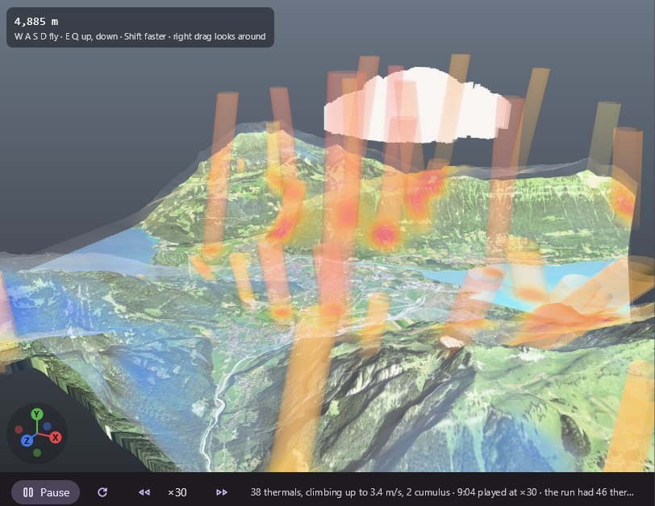

**Game** (M) plays the run's thermals and cumulus as a game would: the convection model below over the base flow, live
(×30 at first; − and = from real time to ×120, Space pauses, Home starts another sky). The thermals rise as leaning
tubes colored by their climb at the moment, fading in and out; the cumulus are the run's own, column by column as Over
time draws them: they start as a wisp's few columns, spread, build and clear as the run's did, their shadows on the
ground along the sun; the slice shows the base flow's lift with the thermals', and particles (P)
ride the model's wind. The bar under the view counts the thermals and cumulus about and the strongest climb against
what the run had about, so flipping between **Over time** (O, the run) and **Game** (M) compares them.

`ParagliderToolbox.Airflow` has no dependencies besides .NET, so a game can use it as it is: `AirflowField.Load` and
`Sample(x, y, z)` for an exported airflow, `AirflowSimulation` to run the solver over its own heightmap.
`ParagliderToolbox.Airflow.Gpu` adds the graphics card's solver (it depends on [ILGPU](https://ilgpu.net)):
`new AirflowSimulation(heights, colors, settings, solver: AirflowGpu.Factory)`.

For an airflow from a Thermals run, `ConvectionModel` plays its thermals and cumulus in a game: thermals rise at the
run's rate, each like one it followed (where it rose, how long it lived, its climb, width, height, lean and drift), grow
and fade over their lives, and the cumulus over them (the run's own shapes, column by column) start as wisps, spread,
build, decay and drift; `model.Advance(dt)` every
frame, `model.WindAt(x, y, z)` is the base flow with the thermals' lift, `model.Clouds` the cumulus to draw. It is
seeded and deterministic however the frames cut the time ([docs/AirflowFormat.md](docs/AirflowFormat.md#playing-it-in-a-game)).
Over Interlaken it keeps about 40 thermals and a few cumulus about at once, as the run did.

## Building

Atelier is referenced as source and expected next to this repository:

```
D:\GitHub\Atelier
D:\GitHub\ParagliderToolbox
```

```bash
dotnet build ParagliderToolbox.slnx
dotnet test
dotnet run --project src/ParagliderToolbox
```

Settings (theme, recent files, shortcuts, layout) are kept in `%APPDATA%\ParagliderToolbox`; downloaded terrain data
in `%LOCALAPPDATA%\ParagliderToolbox\TerrainCache` (Tools > Clear terrain cache).

## Extending

Features are modules (`IToolboxModule`) that register node types, detail views, workspace views, property editors,
JSON converters and menu items with the `Toolbox`. See [CLAUDE.md](CLAUDE.md) for the architecture.
